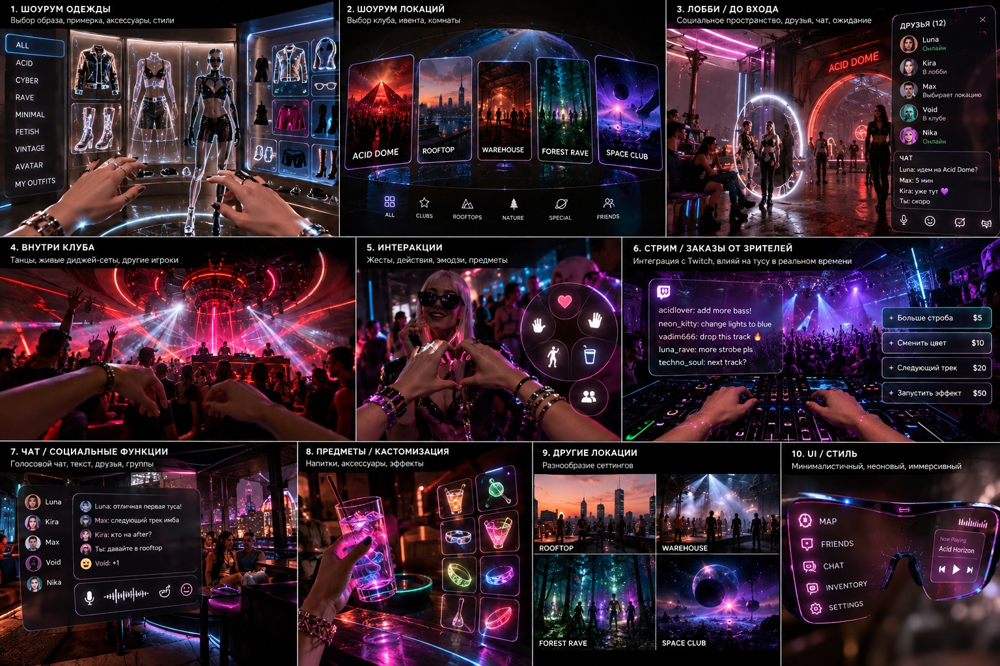
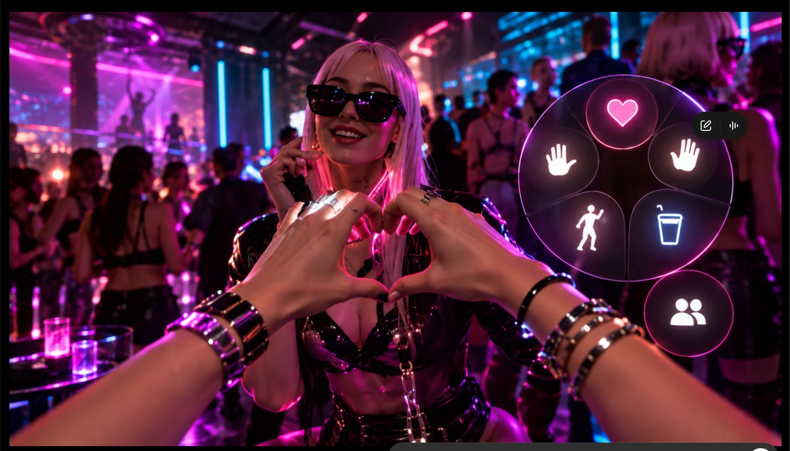

# NEON ROOM visual references

## Screens overview

`neon-room-screens-overview.png` is the general reference for the game's screens and visual language: outfit and venue selection, lobby, nightclub, interaction menu, social panels, items and interface styling. It also depicts proposed social, streaming and destination features; those are visual concepts, not confirmation that they exist in the current game or are part of this port's scope.

## Club close-up

`neon-room-club-closeup.png` is the focused in-club reference. Use it for the nightclub's pink and violet lighting, cyan accents, reflective clothing and surfaces, first-person hands, crowd and circular action menu.
