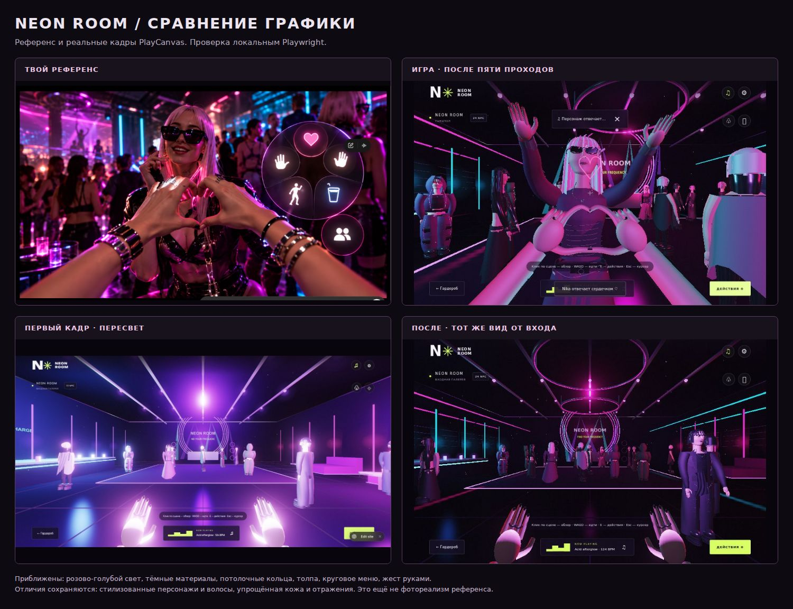

# NEON ROOM visual review

The supplied reference was opened directly and compared with actual screenshots. The comparison below contains the supplied reference and native game frames; no generated illustration stands in for gameplay.

| Pass | Observation | Change / outcome |
| --- | --- | --- |
| 01 | White clipping on hands, skin, clothes and furniture; sparse room. | Recorded the initial state before visual tuning. |
| 02 | Reduced lighting restores black clothing but makes guests too dark. | Added magenta/cyan separation, ceiling rigs, ribbed walls and the radial menu. |
| 03 | More guests improve density but increase rendering cost; a software-rendered screenshot timed out. | Identified draw-call pressure and kept the failure visible in the review record. |
| 04 | Native animated batching retains moving limbs; hand and wardrobe detail are visible. | Softer fill, clearcoat, SVG gestures, pale hair and sunglasses; head/hand pose still differs from the photo. |
| 05 | Darker floor joints and authored light streaks soften the grid appearance; a dedicated hand pose outlines a heart. | Inspected entrance, interaction and heart frames plus a 390×844 phone capture. |

## Captures

- [Initial entrance](club-01-before.jpg)
- [Second entrance](club-02-entrance.jpg)
- [Final entrance](club-05-entrance.jpg)
- [Final interaction menu](club-05-interaction.jpg)
- [Final heart action](club-05-heart.jpg)
- [Phone controls and radial actions](mobile-final.jpg)

## Verification

- `npm test`: 17 passing tests and a successful static build.
- Local Playwright/Chromium desktop runner: no JavaScript errors in completed passes; uses the shipped UI and keyboard controls.
- Local phone runner at 390×844: two independent touch pointers active simultaneously, both released after touch end; all six action targets within the viewport and at least 44 pixels; no JavaScript errors.
- The final action capture freezes Playwright's game clock briefly so a short gesture can be inspected under software rendering. It captures the actual PlayCanvas render, not a painted reconstruction.
- The original Site remains public at its original URL and version 4; the new PlayCanvas Site uses a different project ID and is public.

## Comparison with the reference

The magenta/cyan palette, dark material contrast, ceiling rings, crowd density, glasses, first-person hands and circular controls are closer to the reference than the first pass. The reference still has substantially more realistic anatomy, skin, hair, clothing texture, reflections and photographic depth of field. The current characters remain stylized. Authored floor streaks are an approximation; they do not reflect moving guests. No claim of reference-level photorealism or physical-phone 60 FPS is made.
